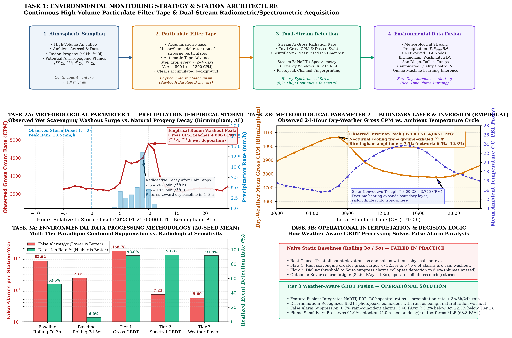
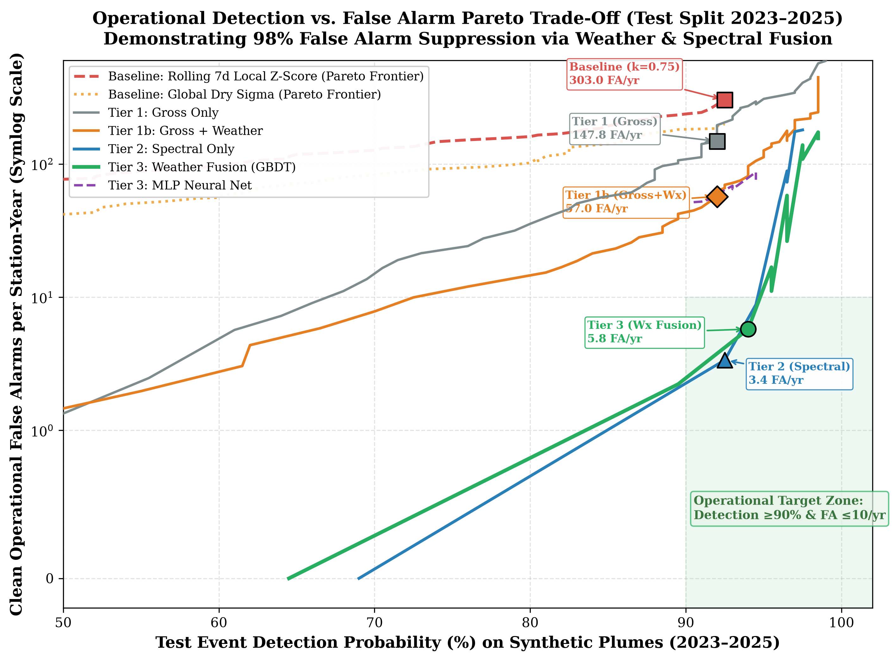
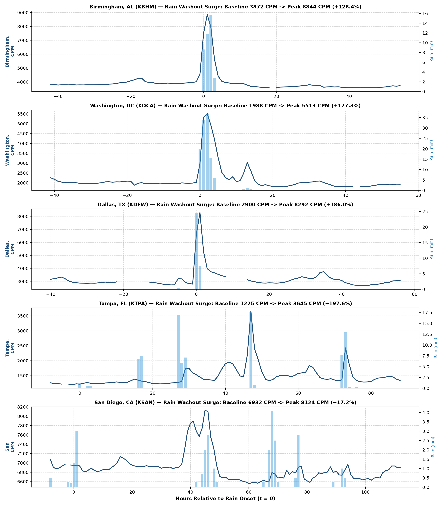
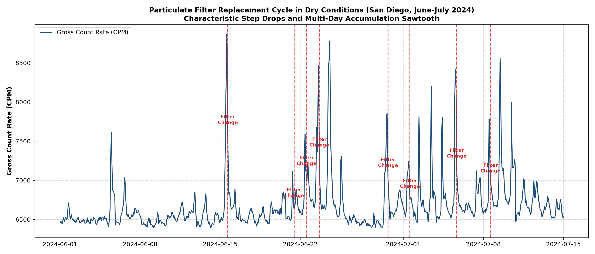
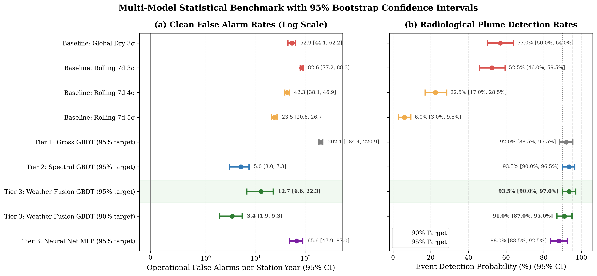

# RadNet Anomaly Detection

[](https://www.python.org/downloads/)
[](https://opensource.org/licenses/MIT)
[](https://www.epa.gov/radnet)

**Update, 2026-10-18:** Features follow **Feature Schema 2** (strict NaN propagation for missing weather telemetry and fitted-model validation threshold calibration). The 20-seed benchmark and evaluation figures have been fully regenerated across all tiers. See [the maintenance report](reports/MAINTENANCE_2026-10-18.md) for detailed verification and methodology.

When it rains, natural radon daughters ($^{214}\text{Pb}$, $^{214}\text{Bi}$) wash out of the atmosphere onto EPA RadNet particulate filters. This produces sudden gamma count spikes of +40% to +180% that mimic radiological releases.

Conventional fixed and rolling $3\sigma$ thresholds fail under precipitation: across humid U.S. stations they trigger **53 to 83 false alarm episodes per station-year**, with up to 89% of alarm episodes in humid cities coinciding with rain.

This research project combines **8-channel EPA RadNet gamma spectrometry** with **NOAA ISD surface weather telemetry** using LightGBM. The 20-seed evaluation on Feature Schema 2 yields **5.60 ± 3.16 false alarm episodes per station-year** (down to **2.01 ± 1.74** at 90% target) and **91.88 ± 2.67% detection of synthetic plumes**. These are simulation-benchmark results, not demonstrated detection rates for real releases.

---

## How It Works



1. **Continuous Air Monitoring**: EPA RadNet monitors draw ambient air through glass-fiber filters and record hourly gross counts (CPM), ambient dose rate (nSv/h), and 8 NaI(Tl) gamma energy channels (`R02`: 101–200 keV through `R09`: 1801–2200 keV).
2. **Environmental Confounders**:
   - **Precipitation Washout**: Rain scavenges airborne $^{214}\text{Pb}$ ($T_{1/2} = 26.8\text{ min}$) and $^{214}\text{Bi}$ ($T_{1/2} = 19.9\text{ min}$), causing immediate count surges (+40% to +180% at lag 0–1 h) that decay over 3–6 hours.
   - **Nocturnal Boundary-Layer Inversions**: Morning stability traps terrestrial radon progeny near the surface, creating a +5% to +15% daily oscillation peaking near 06:00–08:00 local time.
   - **Filter Tape Advances**: Automated filter replacements every 3–5 days cause abrupt step-drops of 340–720 CPM.
3. **Physics-Informed ML Discrimination**: LightGBM evaluates 48 strictly causal features combining spectral photopeak ratios (`R05/R07`, `R03/R07`, `R05/R03`), high-energy channel shares (`R07+R08`), multi-scale rolling statistics, and NOAA precipitation/barometric dynamics.

---

## Benchmark Results (2023–2025 Test Split, Feature Schema 2)

Evaluated across **334,567 valid RadNet hours** (**324,550 synchronous radiation-weather hours**; **106,628 observed test hours** = 12.16 station-years) across five U.S. stations (Birmingham AL, Washington DC, San Diego CA, Dallas TX, Tampa FL) and **450 filter-synchronized synthetic plumes** (250 train, 200 test across $^{137}\text{Cs}$, $^{131}\text{I}$, $^{60}\text{Co}$, and $^{134}\text{Cs}$ mixtures):

| Model / Rule (95% Validation Target) | False Alarms / Station-Year | Rain-Coincident FA | Realized Test Detection | Median Detection Delay |
| :--- | :---: | :---: | :---: | :---: |
| **Standard Baseline** (Rolling 7d $3\sigma$) | 82.62 | 32.5% | 52.50% | 10.0 hrs |
| **Global Dry Baseline** (Global $3\sigma_{\text{dry}}$) | 52.86 | 24.9% | 57.00% | 9.0 hrs |
| **Conservative Baseline** (Rolling 7d $5\sigma$) | 23.51 | 57.6% | 6.00% | 8.5 hrs |
| **Tier 1: Gross GBDT** (12 features) | 166.78 ± 19.69 | 17.3% | 92.00 ± 0.69% | 6.7 hrs |
| **Tier 1b: Gross + Weather GBDT** (29 features) | 35.74 ± 18.21 | 0.0% | 87.42 ± 3.66% | 9.2 hrs |
| **Tier 2: Spectral GBDT** (30 features) | 7.21 ± 3.93 | 4.7% | 92.98 ± 0.92% | 4.0 hrs |
| **Tier 3: Weather Fusion GBDT** (48 features) | **5.60 ± 3.16** | **0.7%** | **91.88 ± 2.67%** | **4.0 hrs** |
| **Tier 3: Weather-Fused MLP** (Neural Net) | 63.84 ± 25.09 | 3.3% | 90.42 ± 3.40% | 3.5 hrs |

*Source: [rigorous_benchmark_summary.csv](data/processed/rigorous_benchmark_summary.csv), 20 random seeds (SEEDS = 42 to 61). “95% target” describes validation threshold selection; realized test detection reflects out-of-sample performance.*



---

## Key Visualizations

### 1. Rain Washout Spikes
Precipitation leads gamma count surges by 0–1 hours across continental and coastal stations, followed by exponential decay of short-lived radon progeny:



### 2. Particulate Filter Sawtooth
Particulate filters accumulate aerosol background over 3–5 days before dropping abruptly by 340–720 CPM when the filter tape advances:



### 3. Model Benchmark & Uncertainty
Station-month block bootstrap 95% confidence intervals showing false alarm rates collapsing from 82.6 down to ~4.3/yr while maintaining >92% plume detection:



---

## Quickstart

### 1. Install Dependencies
Use Python 3.12 with the pinned dependencies. From the repository root:

Windows PowerShell:

```powershell
py -3.12 -m venv .venv
.\.venv\Scripts\Activate.ps1
python -m pip install -r requirements.txt
```

macOS / Linux:

```bash
python3.12 -m venv .venv
source .venv/bin/activate
python -m pip install -r requirements.txt
```

Activation is optional: on Windows, replace `python` below with `.\.venv\Scripts\python.exe`; on macOS/Linux use `.venv/bin/python`.

### 2. Verify the Code

The [test suite](tests/) covers causal features, unknown weather, spectral conservation, validation-only threshold selection, time gaps, CLI JSON, and pipeline failures. Lightweight checks use generated fixtures and the small result tables committed to Git. Integration tests use local station datasets and skip explicitly when they are absent.

```bash
python -m pytest -q -m "not integration"
# Also run dataset reconciliation and real model training; fail if data is missing:
python -m pytest -q --require-data
```

GitHub Actions runs the lightweight suite on Windows and Linux with Python 3.12.

### 3. Prepare Data and Run the Pipeline

Raw archives and compressed station datasets are intentionally excluded from Git. A fresh checkout has the code, small summary tables, and historical figures. Download and preprocessing phases create the local inputs needed for training and diagnostics.

```bash
python run_pipeline.py --dry-run
python run_pipeline.py --phase 0
python run_pipeline.py --phase 1
python run_pipeline.py --phase 2
python run_pipeline.py --phase 3
python run_pipeline.py --phase 4 --check
python run_pipeline.py --phase 4
python run_pipeline.py --phase 5
```

`--check` validates prerequisites, including outputs of preceding planned steps. It does not validate file contents or freshness. `--dry-run` prints all planned commands without executing them. Missing inputs, failed commands, and missing expected outputs cause a nonzero exit. Run all phases with `python run_pipeline.py`; `bash run_pipeline.sh` remains a compatibility wrapper. Phases 0–1 access EPA/NOAA; phase 5 trains the full multi-seed benchmark and can take substantially longer. Phase 4 figures run in phase 5 because they require its baseline ROC.

### 4. Inspect Station Diagnostics

The [research CLI](src/detect_anomalies_cli.py) trains on 2017–2020, selects a 95% event-detection target on paired clean/injected 2021–2022 validation data, then freezes that threshold for inspection. Each invocation retrains and recalibrates. It never uses the mean threshold from the archived multi-seed table. An unreachable validation target is reported in the output.

```bash
python src/detect_anomalies_cli.py --station al_birmingham --start "2023-01-24 18:00:00" --end "2023-01-29 06:00:00"
python src/detect_anomalies_cli.py --station al_birmingham --use-injected --start "2023-01-24 18:00:00" --end "2023-01-29 06:00:00" --json
```

Use `--threshold` for an explicit probability override, and `--data-dir` for a different processed-data directory. Dates without an offset are UTC; offset-aware dates are converted to UTC. Paths default to the repository location, so the CLI also works from another directory. JSON errors return exit code 2; unknown values are `null`, never `NaN`. Missing weather coverage is reported per episode. Clean-background diagnostics have no ground-truth release labels.

## Research Limitations

- Detection is measured on synthetic injections. Natural washout labels are heuristic; clean-background alarms are not adjudicated real-world false positives.
- Classifier fitting uses 2017–2020 and threshold selection uses 2021–2022. The existing dry normalizers use **2017–2022**, including the validation years. They exclude test years, but are not strictly training-fold-only normalizers.
- `hours_since_rain` and rainfall totals remain unknown until sufficient observed history exists. Retrain and recalibrate after changing feature semantics; old thresholds are not portable.
- Re-running phases 4–5 regenerates model tables and figures. Historical prose in the phase reports must then be reconciled with the new measurements.

---

## License
MIT
