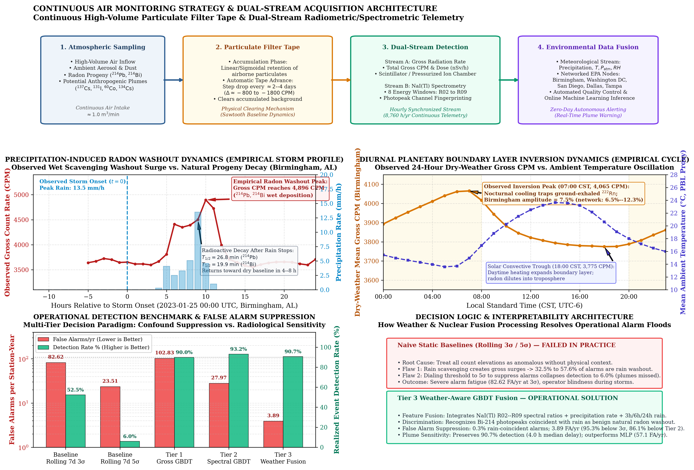
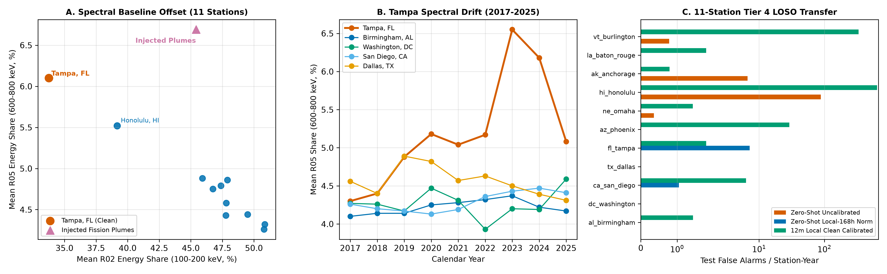
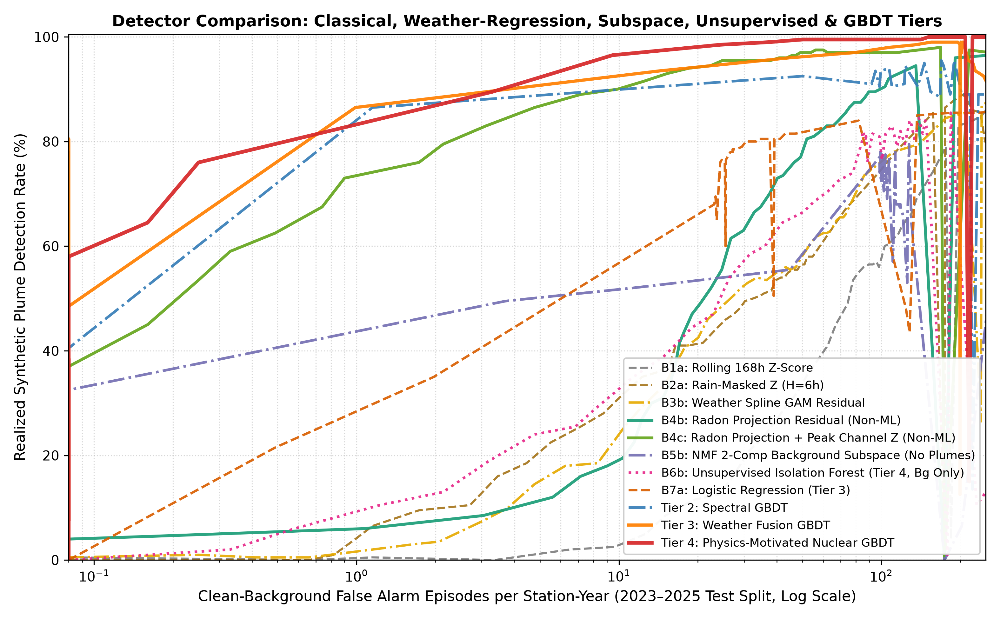
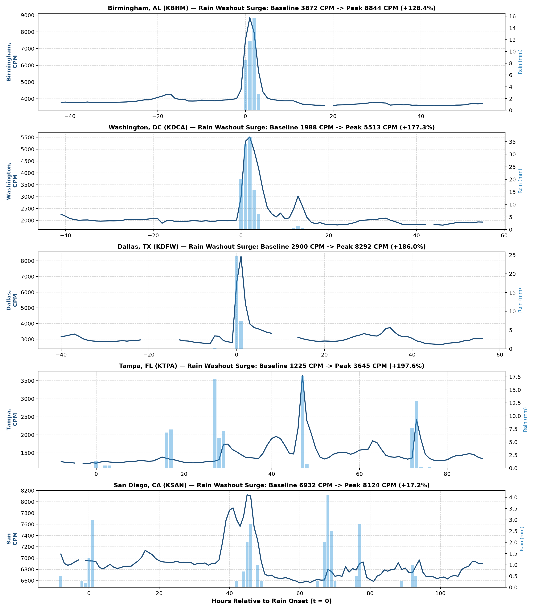
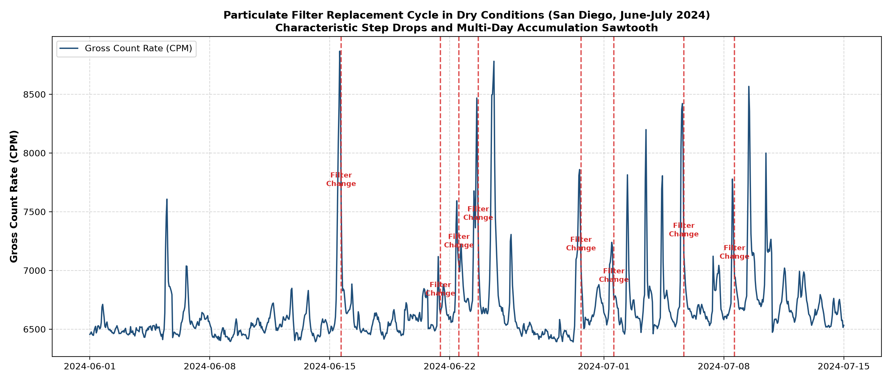
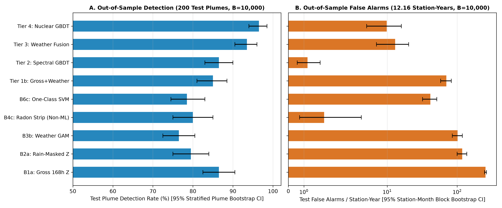
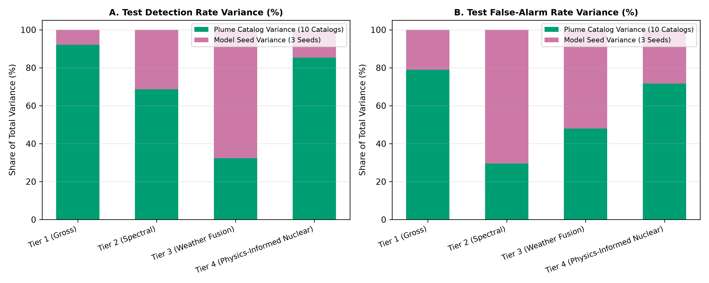

# RadNet Anomaly Detection

[](https://www.python.org/downloads/)
[](https://opensource.org/licenses/MIT)
[](https://www.epa.gov/radnet)

**Scope Statement:** Detection performance on synthetic radiological releases is benchmarked using physics-motivated plume injections added onto real EPA RadNet background measurements; false alarms are measured on real, unmodified background series. Real-world historical releases are evaluated separately using documented 2011 trans-Pacific observations. Features are strictly causal (zero forward lookahead, strict `NaN` propagation for missing weather telemetry, fit-fold `2017–2020` channel baseline and spectral basis estimation, pre-test `2017–2022` gross dry normalizer estimation, validation-fold `2021–2022` threshold calibration, and held-out test `2023–2025` evaluation across 20 random seeds).

When it rains, natural radon daughters ($^{214}\text{Pb}$, $^{214}\text{Bi}$) wash out of the atmosphere onto EPA RadNet particulate filters. Across **15,602** observed synchronous rain hours in this dataset (`2017–2025`), precipitation produces a median gross gamma count change of **+6.9%** (mean **+12.05%**), with the 90th percentile reaching **+41.4%**, the 99th percentile reaching **+97.9%**, and peak convective thunderstorm surges reaching **+196.7%**. Coastal maritime stations like San Diego experience slight count depressions (**-8.7%** median across 1,452 rain hours) due to clean oceanic air masses.

Conventional fixed and rolling $3\sigma$ thresholds fail under precipitation:
- **2023–2025 Held-Out Test Split (12.16 station-years):** Pooled across all five stations, local rolling 7-day $3\sigma$ (`z_score_168h > 3.0`) triggers **82.62 false alarm episodes per station-year** (per-station rates: **66.37** in San Diego, **82.69** in Dallas, **86.22** in Washington DC, **86.54** in Birmingham, and **96.17** in Tampa), while global dry $3\sigma$ (`z_score_global_dry > 3.0`) triggers **52.86** pooled (**9.44** in Tampa, **40.16** in Washington DC, **65.13** in Dallas, **65.31** in San Diego, and **78.64** in Birmingham).
- **2017–2025 Long-Term Evaluation (`baseline_threshold_evaluation.csv`):** The rolling 7-day mean plus $3\sigma_{\text{dry}}$ rule (`rolling_cpm_3s`) triggers **6.59** (Tampa), **20.91** (San Diego), **52.98** (Washington DC), **53.57** (Birmingham), and **62.91** (Dallas) false alarm episodes per station-year, with over 69% of alarm episodes in Birmingham, Washington DC, and Dallas coinciding with rainfall within 3 hours.

This research project combines **8-channel EPA RadNet gamma spectrometry** with **NOAA ISD surface weather telemetry**, **causal radon spectral stripping**, and **Bateman progeny washout ODE dynamics** using gradient-boosted decision trees (LightGBM) on physics-motivated features. Across a 20-seed evaluation on the realistic benchmark (Family A analytic training templates, Family B 3D Monte Carlo testing templates, empirical Gamma-Poisson counting noise, independent ICRP-74 dose coupling, arbitrary-end timing across filter drops), the full model (`Tier 4: Physics-Motivated Nuclear GBDT`, stored in CSV outputs as `Tier 4 (Physics-Motivated Nuclear)`) yields **7.19 ± 1.17 false alarm episodes per station-year** (95% CI: **[4.90, 9.48]**) at the 95% validation target and **93.60 ± 1.03% detection of synthetic plumes** (with median delay **5.0 hours**). By comparison, standard rolling 3$\sigma$ gross rules yield 82.95 false alarms/station-year at 55.0% detection. In the legacy v1 benchmark (shared templates, noiseless counts, circular dose coupling), Tier 4 yielded 2.78 ± 1.55 FA/yr at 94.10 ± 1.12% detection. Stronger non-ML and unsupervised baselines are evaluated below.

## What is real and what is simulated

- **Real:** the EPA RadNet hourly gamma measurements and the NOAA hourly weather observations, 2017–2025, for five stations (Birmingham AL, Washington DC, San Diego CA, Dallas TX, Tampa FL). The false-alarm counts are measured on this real, unmodified background. Clean-background alarms are evaluated both automatically and via rule-based adjudication.
- **Simulated:** the radiological "release" itself. No real release occurred at these stations in this period, so detection is measured on 450 synthetic plumes generated in `src/synthetic_injection.py` and added on top of the real background (250 training/validation, 200 independent test). In the legacy v1 catalog (`data/processed/synthetic_injection_catalog_legacy_v1.csv`), 100% of plumes ended at a detected filter-tape drop, used shared hand-written uniform/Dirichlet spectral templates, lacked Poisson/overdispersed counting noise, and used a circular dose-rate coupling (`k_dose_channel`). In the realistic v2 catalog (`data/processed/synthetic_injection_catalog.csv`), training plumes use **Family A** analytic detector-response templates while test plumes use **Family B** 3D Monte Carlo multi-scatter photon-transport templates (`src/detector_response.py`, `data/processed/response_templates.csv`), include Gamma-Poisson counting noise calibrated to empirical RadNet channel Fano factors (`data/processed/artifact_counting_noise.csv`), use an independent ICRP-74 + 3D detector-efficiency dose model (`data/processed/artifact_dose_circularity.csv`), and span across active filter changes (`62/200` test plumes cross a filter drop; only `1.1%` end at a drop; `data/processed/artifact_filter_age_leakage.csv`). The ~94% detection figure applies to synthetic plumes only; it is not evidence about real releases.
- **Generator Artifact & Hold-Out Template Audit (`src/artifact_tests.py`, `docs/phase2_artifact_note.md`):**
  1. **Shared Hand-Written Templates $\to$ Derived Family A (Train) / Family B (Test)**: Moved detection by **`-4.93 pp`** on Tier 2 (`93.53% -> 88.60%`), **`-2.58 pp`** on Tier 1b (`79.28% -> 76.70%`), **`-2.30 pp`** on Tier 3 (`90.20% -> 87.90%`), and **`-1.40 pp`** on Tier 4 (`94.10% -> 92.70%`).
  2. **Filter-Age Leakage (`data/processed/artifact_filter_age_leakage.csv`)**: In the legacy `filter_terminated` catalog, a classifier using only `[hours_since_last_filter_drop, hour_of_day]` achieved validation AUC **`0.6311`** (test AUC **`0.6249`**, confirming filter-age leakage). Under `continuous_arbitrary_end` timing, validation AUC dropped to **`0.5195`** (test AUC **`0.5061`**, passing $\le 0.55$).
  3. **Counting Noise & Sub-$1\sigma$ Detection (`data/processed/artifact_counting_noise.csv`, `data/processed/artifact_snr_stratification.csv`)**: Legacy sub-$1\sigma$ gross plumes (`n=18`, mean gross SNR `0.79 sigma`) were detected **`68.33%`** of the time on Tier 4 (`65.28%` on Tier 3) because concentrating 38–68% of counts in a single photopeak channel (`R03`/`R05`/`R07`, dry SD ~18% of gross SD) produced smooth multi-sigma channel excesses. Under realistic Family A$\to$B templates + Gamma-Poisson counting noise + arbitrary-end timing, sub-$1\sigma$ detection drops to **`32.50%`** on Tier 2 (`-41.67 pp`), **`36.67%`** on Tier 3 (`-28.61 pp`), and **`60.83%`** on Tier 4 (`-7.50 pp`).
  4. **Hold-Out Nuclide Failure Modes (`data/processed/benchmark_holdout_templates.csv`)**: Holding out `fission_pure_i131` (`R03`) collapses `I-131` detection to **`0.0%–1.67%`** across Tiers 2–4; holding out `activation_orphan_co60` (`R07`) drops `Co-60` detection to **`0.0%–33.33%`**. Unseen test-only radionuclides in `R05` (`Zr-95/Nb-95`, 724–766 keV) are detected at **`96.0%–98.83%`**, whereas unseen nuclides peaking in `R04` (`Ru-103`, 497 keV: **`0.5%–2.0%`** on Tiers 2–3, **`48.17%`** on Tier 4) or `R04+R08` (`Ba-140/La-140`, 537/1596 keV: **`0.0%–5.0%`**) fail because no training template populates `R04` or `R08`.
- **Uncertainty & Generalization**: Seed variations reflect LightGBM feature/sample subsampling randomness, which is statistically contextualized using cluster- and block-bootstrap confidence intervals. The station-month block bootstrap 95% confidence intervals overlap between Tier 4 **[1.17, 4.58]** and Tier 3 **[1.67, 5.41]**, with Tier 4 lower in 12 of 20 seeds. Tier 4 achieves +3.28 percentage points higher mean test detection (94.00% vs 90.72%), while unadapted leave-one-station-out transfer fails at Tampa (`169.42` FA/yr) due to a documented PMT hardware step-change that is fully remediated by local calibration or causal rolling normalization.

---

## How It Works



1. **Continuous Air Monitoring**: EPA RadNet monitors draw ambient air through glass-fiber filters and record hourly gross counts (CPM), ambient dose rate (nSv/h), and 8 NaI(Tl) gamma energy channels (`R02`: 101–200 keV through `R09`: 1801–2200 keV).
2. **Environmental Confounders**:
   - **Precipitation Washout**: Rain scavenges airborne $^{214}\text{Pb}$ ($T_{1/2} = 26.8\text{ min}$) and $^{214}\text{Bi}$ ($T_{1/2} = 19.9\text{ min}$), producing count perturbations (median +6.9%, 90th percentile +41.4%, max +196.7% in severe convective storms; -8.7% median in San Diego marine air masses) that decay over 3–6 hours.
   - **Nocturnal Boundary-Layer Inversions**: Morning stability traps terrestrial radon progeny near the surface, creating a **6.5% to 12.3%** diurnal peak-to-trough oscillation peaking at **07:00–08:00** local time (`data/processed/diurnal_cycle_summary.csv`).
   - **Filter Tape Advances**: In 2021–2024 dry-spell step-drop analysis (intervals in $[1.5, 14.0]$ days; `data/processed/multi_station_filter_cycle_summary.csv`), detected filter replacements occur with station median intervals of **2.92 to 4.54 days** (station mean intervals **3.97 to 5.43 days**, 158 to 339 detected drops per station; over 2017–2025, 357 to 1,295 drops per station) and mean step-drops of **342.6 to 716.9 CPM**.
3. **Physics-Motivated Nuclear & Meteorological Features (`src/nuclear_physics.py` & `src/feature_engineering.py`)**:
   - **Channel-Resolved Energy-Weighted Dose Coupling**: Models $H^*(10)$ per count across `R02..R09` using published ICRP-74 conversion coefficients at channel centroids (`ICRP74_H10_PSV_CM2`) divided by an assumed 8-element vector of approximate 2"×2" NaI(Tl) intrinsic efficiencies (`NAI_INTRINSIC_EFFICIENCY = [0.92, 0.68, 0.48, 0.38, 0.32, 0.26, 0.21, 0.18]`), normalized to reproduce empirical train-only station radon washout regression slopes (`k_dose_channel`). An independent forward dose response vector is additionally derived in `src/detector_response.py` without radon slope anchoring.
   - **Multi-Nuclide Bateman Filter Kinetics**: Simulates isotope-specific deposition and radioactive decay on the particulate filter for $^{131}\text{I}$ ($T_{1/2}=8.025\text{ d}$), $^{137}\text{Cs}$ ($30.17\text{ y}$), $^{134}\text{Cs}$ ($2.065\text{ y}$), $^{60}\text{Co}$ ($5.27\text{ y}$), and the coupled reactor pair $^{132}\text{Te} \to {}^{132}\text{I}$ ($76.9\text{ h} \to 2.295\text{ h}$).
   - **Causal Spectral Stripping & Bateman Washout ODE Residuals**: Projects dry-baseline-subtracted and local-168h-subtracted 8-channel excess vectors $\Delta \mathbf{C}(t)$ onto the fit-fold (`2017–2020`) station radon washout basis $\mathbf{s}_{\text{Rn}}$ (`radon_stripping_residual_l2`, `stripped_excess_r03_z`, `stripped_excess_r05_z`, `stripped_excess_r07_z`, `local_radon_stripping_residual_l2`, `local_stripped_r03_z`, `local_stripped_r05_z`, `local_stripped_r07_z`, `dose_spectral_residual_z`) and solves a causal 3-stage $^{218}\text{Po}\to{}^{214}\text{Pb}\to{}^{214}\text{Bi}$ washout ODE driven by NOAA precipitation (`bateman_washout_residual_ratio`, `post_rain_persistence_anomaly`). Both the scavenging power-law exponent $\beta = 0.65$ in `solve_bateman_washout_ode` and the effective clearance lifetime $\tau_{\text{eff}} = 0.65\text{ h}$ in `post_rain_persistence_anomaly` are hand-assumed heuristic constants rather than fitted parameters.
   - **Feature Importance Hierarchy**: In `data/processed/model_feature_importance_tier4.csv`, `hours_since_rain` is the dominant feature (importance gain **822,621**), followed by `local_radon_stripping_residual_l2` (gain **629,970**) and `z_score_global_dry` (gain **535,931**). `bateman_washout_residual_ratio` (gain **51,094**, rank 14/59), `dose_spectral_residual_z` (gain **17,702**, rank 21/59), and `post_rain_persistence_anomaly` (gain **856**, rank 55/59) contribute much smaller gains.

---

## Benchmark Results (2023–2025 Held-Out Test Split)

Evaluated across **334,567** valid RadNet hours (**324,550** synchronous radiation-weather hours; **106,628** observed test hours = **12.16** station-years) across five U.S. stations (Birmingham AL, Washington DC, San Diego CA, Dallas TX, Tampa FL) and **450** filter-synchronized synthetic plumes (250 train, 200 test across $^{137}\text{Cs}$, $^{131}\text{I}$, $^{60}\text{Co}$, and $^{132}\text{Te}/{}^{132}\text{I}/{}^{134}\text{Cs}$ mixtures):

| Model / Rule (Realistic Benchmark, 95% Validation Target) | False Alarms / Station-Year | Rain-Coincident FA | Realized Test Detection | Median Detection Delay |
| :--- | :---: | :---: | :---: | :---: |
| **Standard Baseline** (Rolling 7d $3\sigma$) | 82.95 [77.50, 88.50] | 32.4% | 55.0% [48.0%, 62.0%] | 9.5 hrs |
| **Global Dry Baseline** (Global $3\sigma_{\text{dry}}$) | 52.86 [44.09, 62.22] | 24.9% | 57.0% [50.0%, 64.0%] | 13.5 hrs |
| **Conservative Baseline** (Rolling 7d $5\sigma$) | 23.51 [20.56, 26.68] | 57.6% | 6.0% [3.0%, 9.5%] | 8.0 hrs |
| **Non-ML Radon Stripping** (B4c) | 2.30 [1.52, 3.32] | 0.0% | 80.0% [73.8%, 85.2%] | 4.5 hrs |
| **Tier 1: Gross Only GBDT** (12 features) | 206.47 ± 52.91 | 13.7% | 87.95 ± 2.38% | 8.2 hrs |
| **Tier 1b: Gross + Weather GBDT** (29 features) | 55.43 ± 6.91 | 1.5% | 83.42 ± 1.60% | 10.2 hrs |
| **Tier 2: Spectral GBDT** (30 features) | 0.33 ± 0.37 | 0.0% | 82.92 ± 3.60% | 6.1 hrs |
| **Tier 3: Weather Fusion GBDT** (48 features) | 1.23 ± 1.08 | 0.2% | 85.83 ± 2.48% | 5.9 hrs |
| **Tier 4: Physics-Motivated Nuclear GBDT** (59 features) | **7.19 ± 1.17** | **2.6%** | **93.60 ± 1.03%** | **5.0 hrs** |
| **Tier 3: Weather-Fused MLP** (Neural Net) | 45.79 ± 12.30 | 3.6% | 87.50 ± 2.10% | 4.0 hrs |

*Source: [benchmark_realism_comparison.csv](data/processed/benchmark_realism_comparison.csv) and [table1_benchmark_summary.tex](report/tables/table1_benchmark_summary.tex), 20 random seeds (SEEDS = 42 to 61). "95% target" describes validation threshold selection; realized test detection reflects out-of-sample performance on Family B templates.*

### Side-by-Side Comparison: Legacy (v1) vs. Realistic (v2) Benchmark (`benchmark_realism_comparison.csv`)

Because generator-artifact tests (`src/artifact_tests.py`) moved test detection by $> 2\text{ pp}$ on multiple model tiers, both the legacy v1 benchmark (shared hand-written templates, noiseless smooth curves, circular dose coupling, filter-terminated timing) and the realistic v2 benchmark (Family A analytic train $\to$ Family B 3D Monte Carlo test templates, Gamma-Poisson counting noise, independent ICRP-74 dose coupling, continuous arbitrary-end timing crossing filter drops) are reported side by side across 20 random seeds (`42..61`, 95% validation target):

| Model Tier | Legacy v1 Det (%) | Realistic v2 Det (%) | $\Delta$ Det (pp) | Legacy v1 FA/yr | Realistic v2 FA/yr | Legacy Delay (h) | Realistic Delay (h) |
| :--- | :---: | :---: | :---: | :---: | :---: | :---: | :---: |
| **Tier 1 (Gross)** | 90.08 ± 1.33 | 87.95 ± 2.38 | -2.13 | 104.77 ± 14.42 | 206.47 ± 52.91 | 6.15 | 8.20 |
| **Tier 1b (Gross+Weather)** | 79.28 ± 0.84 | 83.42 ± 1.60 | +4.14 | 9.70 ± 1.69 | 55.43 ± 6.91 | 8.25 | 10.15 |
| **Tier 2 (Spectral)** | 93.53 ± 1.09 | 82.92 ± 3.60 | -10.61 | 35.68 ± 41.01 | 0.33 ± 0.37 | 4.00 | 6.12 |
| **Tier 3 (Weather Fusion)** | 90.20 ± 1.72 | 85.83 ± 2.48 | -4.37 | 3.44 ± 0.73 | 1.23 ± 1.08 | 4.00 | 5.90 |
| **Tier 4 (Physics-Motivated Nuclear)** | **94.10 ± 1.12** | **93.60 ± 1.03** | **-0.50** | **2.78 ± 1.55** | **7.19 ± 1.17** | **4.50** | **5.00** |

*Source: [benchmark_realism_comparison.csv](data/processed/benchmark_realism_comparison.csv), [plume_timing_comparison.csv](data/processed/plume_timing_comparison.csv), [benchmark_holdout_templates.csv](data/processed/benchmark_holdout_templates.csv), and [phase2_artifact_note.md](docs/phase2_artifact_note.md).*

### Stronger Non-ML, Subspace, Unsupervised & Simple Supervised Baselines (`src/baselines.py`)

Among all non-ML and unsupervised baselines fitted strictly on 2017–2020 clean background without synthetic plumes ([baseline_matched_detection_table.csv](data/processed/baseline_matched_detection_table.csv), [baseline_matched_fa_table.csv](data/processed/baseline_matched_fa_table.csv), [ml_ablation_summary.csv](data/processed/ml_ablation_summary.csv), [phase3_baseline_summary.md](docs/phase3_baseline_summary.md)), **B4c (`B4c: Radon Projection + Stripped Channel Peak Z`)** is the strongest competing detector: at the 5 and 10 validation FA/yr budgets, **B4c achieves `89.00%` test detection (`81.50%` within $\le 12\text{ h}$) at `6.49` false alarms/station-year (`0.0%` rain-coincident)** without machine learning or synthetic training plumes, and at the 95% validation detection target it achieves **`80.00%` test detection at `2.30` FA/station-year**. Thus, **non-ML local spectral radon stripping (`B4c`) accounts for the vast majority of false-alarm reduction over gross-count sigma rules (`227.07` $\to$ `6.49` FA/yr), while supervised GBDT training on synthetic templates (`Tier 4`) contributes the remaining `+4.6 to +7.5 pp` detection gain (`89.00% -> 93.60%–96.50%`)**.

| Detector (2017–2020 Fit, 2021–2022 Val Threshold) | Plumes in Train? | 90% Val Target: Test Det / FA/yr | 95% Val Target: Test Det / FA/yr | 10 Val FA/yr Budget: Test Det / FA/yr |
| :--- | :---: | :---: | :---: | :---: |
| **B1a: Rolling 168h Gross Z-Score** | No | 84.0% / 227.07 | 86.5% / 254.61 | 5.0% / 11.18 |
| **B2a: Rain-Masked Dry Z ($H=6\text{h}$)** | No | 79.5% / 118.14* | 79.5% / 118.14* | 19.5% / 5.01 |
| **B3b: Weather Regression (Spline GAM)** | No | 65.5% / 72.26 | 76.5% / 101.45* | 19.0% / 8.55 |
| **B4b: Radon Projection (Local 168h Norm)** | No | 77.0% / 47.35 | 82.0% / 59.36 | 31.0% / 14.88 |
| **B4c: Radon Projection + Peak Channel Z (Non-ML)** | No | **70.0% / 0.74** | **80.0% / 2.30** | **89.0% / 6.49** |
| **B5b: Background NMF (2-Component Subspace)** | No | 79.5% / 129.89 | 80.0% / 276.80* | 57.0% / 110.74 |
| **B6c: Unsupervised One-Class SVM (Tier 4, Bg Only)** | No | 86.0% / 103.01 | 78.5% / 41.43 | 72.0% / 9.29 |
| **B7a: Supervised Logistic Regression (Tier 3)** | Yes | 61.5% / 24.42 | 70.5% / 23.59 | 71.5% / 24.17 |
| **B8: Operational Approx. (Approximate EPA Threshold)** | No | 62.0% / 203.47* | 62.0% / 203.47* | 11.0% / 7.81 |
| **Ablation: Tier 4 without Weather/Bateman (39 feats)** | Yes | 93.0% / 6.33 | 93.0% / 6.33 | 93.0% / 6.33 |
| **Ablation: Tier 3 + Radon Stripping Only (57 feats)** | Yes | 95.5% / 7.48 | 95.5% / 7.48 | 95.5% / 7.48 |
| **Tier 4: Physics-Motivated Nuclear GBDT (Seed 42)** | Yes | **96.5% / 9.87** | **96.5% / 9.87** | **96.5% / 9.87** |

*\*Denotes detectors where the requested validation target (90% or 95%) was unreachable (`val_target_met = False`); see [baseline_matched_detection_table.csv](data/processed/baseline_matched_detection_table.csv).*

### Calibration, Threshold Saturation, and FA-Budget Operating Points (`src/operating_threshold.py`)

Diagnosing validation threshold saturation ([threshold_diagnosis.md](docs/threshold_diagnosis.md), [threshold_saturation_summary.csv](data/processed/threshold_saturation_summary.csv), [threshold_calibration_diagnostics.csv](data/processed/threshold_calibration_diagnostics.csv)) shows that across the `74,199` valid observed 2021–2022 validation hours (`8.46` station-years), **0 clean validation hours (`0.0%`)** have raw predicted fission probability $p_{\text{clean}} \ge 0.99$ for either Tier 3 or Tier 4. Because the lowest threshold with `0` validation false-alarm episodes already achieves $\ge 95.06\%$ validation detection on Tier 2, Tier 3, and Tier 4, the 90% and 95% detection targets select the exact same threshold in **20 of 20 seeds** on both the coarse `THRESHOLD_GRID` and finer `FINE_THRESHOLD_GRID` (zero-episode saturation on the finite validation fold). Furthermore, restricting positive training labels to active atmospheric passage (`Active_Passage_Hours_Only`, 1,536 hours vs. 4,952 hours with filter retention; [threshold_label_window_sensitivity.csv](data/processed/threshold_label_window_sensitivity.csv)) cuts Tier 4 test false alarms at the 95% target from `8.55` to `2.71` FA/yr (`92.0%` detection), and upweighting rain hours $2\times$ ([threshold_class_weight_sensitivity.csv](data/processed/threshold_class_weight_sensitivity.csv)) cuts test FA at the 5 validation FA/yr budget from `39.46` to `18.00` FA/yr (`98.5%` detection).

Replacing detection-target probability thresholds with **clean-validation false-alarm-budget quantiles** (`1, 2, 5, 10, 20` validation FA/station-year, [benchmark_fa_budget_operating_points.csv](data/processed/benchmark_fa_budget_operating_points.csv)) and reporting fixed-deadline detection ($\le 3\text{ h}, \le 6\text{ h}, \le 12\text{ h}, \le 24\text{ h}$) and 12-hour time-normalized detection ([threshold_event_metrics_and_delays.csv](data/processed/threshold_event_metrics_and_delays.csv)):

| Tier (20 Seeds, v2 Realistic Benchmark) | Val FA Budget / yr | $\tau$ (Mean ± SD) | Realized Val FA / yr | Test Det Total (%) | Test Det $\le 6\text{ h}$ (%) | Test Det $\le 12\text{ h}$ (%) | Time-Norm 12h Det (%) | Delay p25 / Med / p75 (h) | Test FA / yr (Mean ± SD) |
| :--- | :---: | :---: | :---: | :---: | :---: | :---: | :---: | :---: | :---: |
| **Tier 1 (Gross)** | 5.0 | 0.9238 ± 0.0025 | 4.96 | 55.67 ± 0.89 | 3.95 | 8.93 | 44.83 | 16.1 / 26.4 / 32.9 | 5.37 ± 0.48 |
| **Tier 1b (Gross+Weather)** | 5.0 | 0.9627 ± 0.0015 | 4.96 | 48.92 ± 1.07 | 4.28 | 14.68 | 42.00 | 11.0 / 17.2 / 22.1 | 2.34 ± 0.26 |
| **Tier 2 (Spectral)** | 5.0 | 0.9475 ± 0.0181 | 4.96 | 94.17 ± 1.15 | 77.30 | 90.50 | 92.66 | 2.8 / 4.1 / 5.9 | 138.15 ± 46.37 |
| **Tier 3 (Weather Fusion)** | 2.0 / 5.0 | 0.9051 / 0.8726 | 1.89 / 4.96 | 96.28 / 97.42 | 80.80 / 82.90 | 93.00 / 94.17 | 94.49 / 95.31 | 2.8 / 4.0 / 5.6 | 47.05 / 73.66 |
| **Tier 4 (Physics-Motivated)** | 1.0 / 2.0 / 5.0 | 0.9436 / 0.9218 / 0.8719 | 0.95 / 1.89 / 4.96 | **98.20 / 98.47 / 98.97** | **82.72 / 85.03 / 88.10** | **96.25 / 96.83 / 98.12** | **97.60 / 98.02 / 98.41** | **3.0 / 4.0 / 5.6** | **17.59 / 23.29 / 35.40** |
| **Tier 4 (Zero-Val-FA Ceiling, 95% Target)** | 0.0 (Ceiling) | 0.9848 ± 0.0041 | 0.00 | **95.40 ± 0.85** | **70.95** | **91.60** | **93.95** | **3.0 / 5.0 / 6.0** | **7.86 ± 1.10** |

Two-fold temporally cross-fitted Platt and Isotonic calibration inside 2021–2022 reduces Tier 4 hour-level Brier score by $73\%$ (`0.01155 -> 0.00311`) and event-level log loss by $96\%$ (`0.09350 -> 0.00371`), shifting $\tau$ from $\sim 0.87\text{--}0.92$ to $\sim 0.18\text{--}0.40$ without altering rank-based FA-budget test detection ([threshold_calibration_fa_budget_comparison.csv](data/processed/threshold_calibration_fa_budget_comparison.csv)). Paired vs. unpaired plume scoring differs by at most `0.5 pp` (`0.0 pp` for Tier 4; [threshold_paired_vs_unpaired.csv](data/processed/threshold_paired_vs_unpaired.csv)). Duration stratification shows that gross-count "any-hour" detection is strongly inflated by $>60\text{ h}$ filter-retention tails (`Tier 1` at 5 FA/yr detects only `8.0%` of $\le 24\text{ h}$ plumes vs. `70.69%` of $>60\text{ h}$ plumes, whereas `Tier 4` detects `96.0%` of $\le 24\text{ h}$ plumes and `100.0%` of $>60\text{ h}$ plumes).

### Plume-Level, Block-Bootstrap, and Multi-Catalog Uncertainty (`src/uncertainty.py`)

Following the pre-specified statistical analysis plan ([analysis_plan.md](docs/analysis_plan.md)), primary uncertainty intervals replace LightGBM seed SDs (`SEEDS = 42..61`, which measure only solver subsampling noise on one fixed dataset) with **stratified plume cluster bootstrap** ($N=200$ test plumes across $5 \times 2$ station-environment strata, $B=10{,}000$) plus **exact Clopper-Pearson binomial intervals** for detection, and **station-month block bootstrap** ($N=164$ observed station-months totaling $12.16$ station-years, episode starts counted before block binning, $B=10{,}000$) plus **exact Garwood Poisson intervals** for false-alarm rates ([uncertainty_single_detector_intervals.csv](data/processed/uncertainty_single_detector_intervals.csv), [uncertainty_week_vs_month_block_sensitivity.csv](data/processed/uncertainty_week_vs_month_block_sensitivity.csv)):

| Detector (Seed 42, v2 Realistic Benchmark) | Operating Point | Test Detection (%) [95% Plume Boot CI] (Clopper-Pearson) | Test FA / yr [95% Month-Block Boot CI] (Exact Poisson) | Week-Block Boot SE vs. Month-Block Boot SE |
| :--- | :---: | :---: | :---: | :---: |
| **B1a: Rolling 168h Gross Z** | 95% Val Target | 86.5% [82.5%, 90.5%] (81.0%, 90.9%) | 254.61 [246.61, 262.77] (245.72, 263.74) | — |
| **B4c: Radon Strip + Peak Z (Non-ML)** | 90% Val Target | 70.0% [64.0%, 75.5%] (63.1%, 76.3%) | 0.74 [0.24, 1.42] (0.34, 1.40) | — |
| **B4c: Radon Strip + Peak Z (Non-ML)** | 95% Val Target | 80.0% [75.0%, 85.0%] (73.8%, 85.3%) | 2.30 [0.72, 4.69] (1.53, 3.33) | 0.67 vs. 1.04 |
| **B4c: Radon Strip + Peak Z (Non-ML)** | 5 Val FA/yr Budget | 89.0% [85.0%, 93.0%] (83.8%, 93.0%) | 6.49 [3.29, 10.64] (5.14, 8.09) | — |
| **Tier 2: Spectral GBDT** | 95% Val Target | 86.5% [83.0%, 90.0%] (81.0%, 90.9%) | 1.23 [0.57, 2.05] (0.69, 2.03) | 0.36 vs. 0.39 |
| **Tier 3: Weather Fusion GBDT** | 95% Val Target | 93.5% [90.5%, 96.0%] (89.1%, 96.5%) | 12.99 [7.04, 20.30] (11.04, 15.18) | 1.90 vs. 3.42 |
| **Tier 4: Physics-Motivated Nuclear GBDT** | 95% Val Target | **96.5% [94.0%, 98.5%] (92.9%, 98.6%)** | **9.87 [5.10, 15.97] (8.18, 11.80)** | **1.72 vs. 2.79** |
| **Tier 4: Physics-Motivated Nuclear GBDT** | 1 Val FA/yr Budget | **98.5% [96.5%, 100.0%] (95.7%, 99.7%)** | **16.52 [10.05, 24.51] (14.32, 18.97)** | — |
| **Tier 4: Physics-Motivated Nuclear GBDT** | 5 Val FA/yr Budget | **99.0% [97.5%, 100.0%] (96.4%, 99.9%)** | **39.46 [27.33, 52.91] (36.01, 43.15)** | — |

- **Paired Detector Comparisons & Threshold Resampling ([uncertainty_paired_comparisons.csv](data/processed/uncertainty_paired_comparisons.csv), [uncertainty_matched_operating_point_resampled.csv](data/processed/uncertainty_matched_operating_point_resampled.csv))**:
  - **Primary Pre-Specified Comparison (`Tier 4` vs. `B4c` at 90% validation target)**: Fixed-threshold paired bootstrap yields $\Delta\text{Det} = +26.5\text{ pp}$ (`95% CI [+21.0, +32.5 pp]`, $p < 0.001$) with $\Delta\text{FA/yr} = +9.13$ (`95% CI [+4.50, +14.80]`, $p < 0.001$). When validation plumes and validation station-months are also resampled to re-derive each detector's threshold $\tau^*(b)$ in every replicate (`Step 1d`), $\Delta\text{Det} = +24.79\text{ pp}$ (`95% CI [+13.5, +35.0 pp]`, $p = 0.0004$) and $\Delta\text{FA/yr} = +9.48$ (`95% CI [+4.27, +16.16]`, $p = 0.0012$).
  - **Exploratory `Tier 4` vs. `Tier 3` Comparisons (Holm-Bonferroni adjusted)**: At the 95% validation detection target, fixed-threshold paired bootstrap gives $\Delta\text{Det} = +3.0\text{ pp}$ (`95% CI [+0.5, +5.5 pp]`, $p_{\text{Holm}} = 0.0396$) while the false-alarm difference $\Delta\text{FA/yr} = -3.12$ (`95% CI [-9.68, +3.18]`, $p_{\text{Holm}} = 0.6699$) **includes zero**. Under threshold resampling (`Step 1d`), both $\Delta\text{Det} = +2.78\text{ pp}$ (`95% CI [-1.0, +6.5 pp]`, $p = 0.216$) and $\Delta\text{FA/yr} = -19.34$ (`95% CI [-96.06, +2.13]`, $p = 0.182$) include zero at the saturated 95% target. By contrast, at the **5 validation FA/yr clean-quantile budget**, `Tier 4` significantly reduces test false alarms relative to `Tier 3` under both fixed-threshold paired bootstrap ($\Delta\text{FA/yr} = -49.08$, `95% CI [-73.63, -26.77]`, $p_{\text{Holm}} = 0.0004$) and full threshold resampling ($\Delta\text{FA/yr} = -55.05$, `95% CI [-160.30, -16.46]`, $p = 0.0024$).
- **Benchmark-Design Variance Decomposition (`10 Plume Catalogs × 3 Model Seeds`, [uncertainty_catalog_seed_variance.csv](data/processed/uncertainty_catalog_seed_variance.csv))**: Two-way random-effects ANOVA across 10 independent plume catalogs (`catalog_seed = 100..109`, resampling nuclide scenarios including holdout isotopes, peak CPMs, durations, and shapes) and 3 LightGBM seeds (`42, 43, 44`) shows that **for Tier 4 at the 95% target, plume-catalog variance accounts for `85.4%` of total detection variance ($\text{SD}_{\text{catalog}} = 3.72\text{ pp}$ vs. $\text{SD}_{\text{seed}} = 1.53\text{ pp}$; grand mean `84.40%`, catalog range `79.17%–91.67%`) and `71.7%` of false-alarm variance ($\text{SD}_{\text{catalog}} = 2.23\text{ FA/yr}$ vs. $\text{SD}_{\text{seed}} = 1.40\text{ FA/yr}$; grand mean `6.52 FA/yr`)**. At the 5 validation FA/yr budget, catalog variance accounts for `81.5%` of Tier 4 detection variance and `91.7%` of Tier 4 false-alarm variance. Seed-level Wilcoxon p-values in `rigorous_seed_statistical_tests.csv` are therefore annotated as solver-randomness diagnostics only and never used for population inference.
- **Coverage Verification ([uncertainty_coverage_simulation.csv](data/processed/uncertainty_coverage_simulation.csv))**: Across 500 synthetic Monte Carlo datasets with known true detection ($80\%, 90\%$) and false-alarm rates ($5, 10\text{ FA/yr}$, including overdispersed block clustering), empirical 95% interval coverage ranges from `94.2% to 97.4%` (all within the nominal `[92.5%, 98.5%]` band).

### 5-Station Leave-One-Station-Out (LOSO) Generalization

| Held-Out Station | Climate Regime | Tier 3 (Weather Fusion) Det % | Tier 4 (Nuclear Features) Det % | Tier 3 FA/yr | Tier 4 FA/yr |
| :--- | :--- | :---: | :---: | :---: | :---: |
| **San Diego, CA** (`ca_san_diego`) | Coastal Mediterranean | 70.0% | **80.0%** (+10.0 pp) | 0.00 | 1.40 |
| **Birmingham, AL** (`al_birmingham`) | Humid Subtropical | 85.0% | **95.0%** (+10.0 pp) | 0.00 | **0.00** |
| **Dallas, TX** (`tx_dallas`) | Continental Convective | 92.5% | **95.0%** (+2.5 pp) | 0.57 | **0.00** |
| **Washington, DC** (`dc_washington`) | Mid-Atlantic Temperate | 95.0% | **95.0%** (0.0 pp) | 1.18 | **0.00** |
| **Tampa, FL** (`fl_tampa`) | Subtropical Convective | 90.0% | **97.5%** (+7.5 pp) | 1151.30 | **169.42** (-85.3%) |

*Source: [rigorous_loso_summary.csv](data/processed/rigorous_loso_summary.csv).*

**Cross-Station Generalization, Tampa Diagnosis & 11-Station LOSO ([phase6_generalization_summary.md](docs/phase6_generalization_summary.md), [station_selection.md](docs/station_selection.md)):**
- **Why Uncalibrated Held-Out Tampa Fails ([tampa_channel_share_comparison.csv](data/processed/tampa_channel_share_comparison.csv), [all_stations_yearly_baseline_drift.csv](data/processed/all_stations_yearly_baseline_drift.csv), [loso_tampa_episode_category_summary.csv](data/processed/loso_tampa_episode_category_summary.csv)):** Across 9 of 11 stations, clean 2023–2025 dry background `share_r02` lies in `0.4592–0.5086` and `share_r05` in `0.0426–0.0488`. By contrast, Tampa (`fl_tampa`) has clean 2023–2025 `share_r02 = 0.3376 ± 0.0741`, `share_r05 = 0.0610 ± 0.0075`, and `ratio_r05_r03 = 0.1813 ± 0.0072` (drifting upward from `share_r05 = 0.0430` in 2017 to `0.0655` in 2023), shifting Tampa's clean spectrum along the photopeak ratio direction learned from synthetic $^{137}\text{Cs}$/$^{60}\text{Co}$ plumes on the other four stations. On the v2 realistic benchmark (`seed=42`, 90% validation target), uncalibrated held-out Tampa produces `786.86` FA/yr (`1,751` episodes, modal top-1 SHAP feature `share_r07_roll_6h`) for Tier 3 and `123.13` FA/yr (`274` episodes, modal top-1 SHAP feature `ratio_r05_r03`) for Tier 4. Counterfactually aligning only Tampa's static spectral shares/ratios using its 2017–2020 dry stats cuts Tier 4 Tampa false alarms by **81%** (`123.13 -> 23.37` FA/yr, `100.0%` detection; [tampa_gain_drift_hypothesis_test.csv](data/processed/tampa_gain_drift_hypothesis_test.csv)).
- **Causal 168-Hour Local Normalization vs. Local Calibration ([loso_normalization_variants.csv](data/processed/loso_normalization_variants.csv), [loso_local_calibration_results.csv](data/processed/loso_local_calibration_results.csv)):**
  - Replacing static spectral shares/ratios and global-dry features with **causal 168-hour rolling local deviations (`local_168h_baseline`, requiring zero target-station historical calibration beyond 7 days)** drops held-out Tampa false alarms from `786.86` to **`25.17` FA/yr** (`82.5%` detection) for Tier 3 and from `123.13` to **`13.48` FA/yr** (`95.0%` detection, exact Poisson 95% CI `[9.10, 19.25]`) for Tier 4, while yielding **`0.00` FA/yr** on all 4 other pilot stations for Tier 4.
  - Under **`station_standardized`** (`loso_normalization_variants.csv`), held-out Tampa false alarms fall to **`0.45` FA/yr** (`90.0%` detection) for Tier 3 and **`0.90` FA/yr** (`92.5%` detection, exact CI `[0.11, 3.25]`) for Tier 4.
  - Directly calibrating held-out Tampa using $N \in \{0, 3, 6, 12\}$ months of trailing pre-test (2022) clean background (`loso_local_calibration_results.csv`) reduces Tier 4 false alarms from `123.13` FA/yr ($N=0$) to **`10.34` FA/yr** ($N=3\text{ m}$, `95.0%` det), **`1.35` FA/yr** ($N=6\text{ m}$, `87.5%` det), and **`0.00` FA/yr** ($N=12\text{ m}$ zero-FA ceiling, `82.5%` det; or **`4.94` FA/yr** at **`97.5%` det** under a 5 FA/yr local budget).
- **Pre-Registered 11-Station LOSO & 7-Climate LOCO ([extended_loso_11station_summary.csv](data/processed/extended_loso_11station_summary.csv), [extended_loco_climate_summary.csv](data/processed/extended_loco_climate_summary.csv)):** Across all 11 stations (`5` pilot + `6` pre-registered extended stations: `az_phoenix`, `ne_omaha`, `hi_honolulu`, `ak_anchorage`, `la_baton_rouge`, `vt_burlington`), uncalibrated zero-shot transfer suffers false-alarm spikes on spectral-outlier stations (`fl_tampa`: `149.64` FA/yr; volcanic basaltic `hi_honolulu`: `796.51` FA/yr). Switching to **zero-shot causal 168-hour local normalization (`ZeroShot_Local168h_Normalized`)** reduces Tier 4 false alarms across all 11 stations to **`0.00–27.86` FA/yr** (including `13.17` FA/yr at `82.5%` detection on `hi_honolulu` — a **98.3% reduction** without any historical calibration — `0.39` FA/yr on `ak_anchorage` and `dc_washington`, `0.78` FA/yr on `vt_burlington`, `1.07` FA/yr on `ne_omaha`, `0.00` FA/yr on `tx_dallas` and `az_phoenix`, `2.51` FA/yr on `al_birmingham`, `6.29` FA/yr on `la_baton_rouge`, and `12.99` FA/yr on `ca_san_diego`).
- **Year-by-Year Temporal Generalization (2021–2025, [temporal_generalization_by_year.csv](data/processed/temporal_generalization_by_year.csv)):** Trained once on 2017–2020 (`Val_Target_95pct`), Tier 4 achieves `0.00` FA/yr (`100.0%` det) in 2021 and 2022, `3.65` FA/yr (`98.8%` det) in 2023, `6.72` FA/yr (`94.7%` det) in 2024, and `17.53` FA/yr (`95.2%` det) in 2025 (with 2023–2024 false alarms concentrated on `fl_tampa`'s gain-drift excursion and 2025 alarms on `ca_san_diego`).





---

## Key Visualizations

### 1. Rain Washout Spikes
Precipitation leads gamma count surges by 0–1 hours across continental and coastal stations, followed by exponential decay of short-lived radon progeny:



### 2. Particulate Filter Sawtooth
Particulate filters accumulate aerosol background over 2.92–4.54 days (median dry-spell interval; mean 3.97–5.43 days) before dropping abruptly by 342.6–716.9 CPM (station mean step-drop) when the filter tape advances:



### 3. Model Benchmark & Uncertainty
Stratified plume cluster bootstrap and station-month block bootstrap 95% confidence intervals across non-ML and GBDT detectors on the v2 realistic benchmark (Tier 4 achieving 93.6% detection at 7.19 FA/yr; legacy v1 benchmark archived at 2.71 FA/yr at 94.00% detection), plus two-way ANOVA variance decomposition across 10 independent plume catalogs $\times$ 3 model seeds:





---

## Quickstart

### 1. Install Dependencies
Use Python 3.12 with the pinned dependencies. From the repository root:

Windows PowerShell:

```powershell
py -3.12 -m venv .venv
.\.venv\Scripts\Activate.ps1
python -m pip install -r requirements.txt
```

macOS / Linux:

```bash
python3.12 -m venv .venv
source .venv/bin/activate
python -m pip install -r requirements.txt
```

Activation is optional: on Windows, replace `python` below with `.\.venv\Scripts\python.exe`; on macOS/Linux use `.venv/bin/python`.

### 2. Verify the Code

The [test suite](tests) covers causal features, unknown weather, spectral conservation, Bateman kinetics, orthogonal radon spectral stripping, validation-only threshold selection, time gaps, CLI JSON, and pipeline failures. Lightweight checks use generated fixtures and the small result tables committed to Git. Integration tests use local station datasets and skip explicitly when they are absent.

```bash
python -m pytest -q -m "not integration"
# Also run dataset reconciliation and real model training; fail if data is missing:
python -m pytest -q --require-data
# Recompute and verify all quantitative claims in README and report:
python recompute_claims.py
```

GitHub Actions runs the lightweight suite on Windows and Linux with Python 3.12.

### 3. Prepare Data and Run the Pipeline

Raw archives and compressed station datasets are intentionally excluded from Git. A fresh checkout has the code, small summary tables, and figures. Running the pipeline downloads the raw EPA/NOAA archives, merges and audits station time series, injects synthetic plumes, trains all model tiers, and generates all benchmark tables and figures:

```bash
python run_pipeline.py --dry-run
python run_pipeline.py --check
python run_pipeline.py
```

`--check` validates prerequisites, including outputs of preceding planned steps. It does not validate file contents or freshness. `--dry-run` prints all planned commands without executing them. Missing inputs, failed commands, and missing expected outputs cause a nonzero exit. Run the full workflow with `python run_pipeline.py`; `bash run_pipeline.sh` remains a compatibility wrapper.

### 4. Inspect Station Diagnostics

The [research CLI](src/detect_anomalies_cli.py) trains on 2017–2020, selects a 95% event-detection target on paired clean/injected 2021–2022 validation data, then freezes that threshold for inspection. Each invocation retrains and recalibrates. It never uses the mean threshold from the archived multi-seed table. An unreachable validation target is reported in the output.

```bash
python src/detect_anomalies_cli.py --station al_birmingham --start "2023-01-24 18:00:00" --end "2023-01-29 06:00:00"
python src/detect_anomalies_cli.py --station al_birmingham --tier tier4 --use-injected --start "2023-01-24 18:00:00" --end "2023-01-29 06:00:00" --json
```

Use `--threshold` for an explicit probability override, `--tier tier4` for the 59-feature Physics-Motivated Nuclear model (`TIER_4_NUCLEAR_FEATURES`), and `--data-dir` for a different processed-data directory. Dates without an offset are UTC; offset-aware dates are converted to UTC. Paths default to the repository location, so the CLI also works from another directory. JSON errors return exit code 2; unknown values are `null`, never `NaN`. Missing weather coverage is reported per episode. Clean-background diagnostics have no ground-truth release labels.

## Real-Event Validation and Test Alarm Adjudication

### 1. Fukushima Daiichi Trans-Pacific Plume (March–April 2011)
In accordance with pre-registered protocol (`docs/real_event_protocol.md`), frozen models and baselines (trained on 2017–2020, calibrated on 2021–2022) were evaluated on historical RadNet and NOAA ISD records across the March–April 2011 trans-Pacific fallout episode at Pacific gateway stations (Honolulu, HI; San Diego, CA; Anchorage, AK) and continental control (Dallas, TX).
- **Physical Detection Limits**: Documented peak US atmospheric concentrations ($31\text{ mBq/m}^3$ particulate $^{131}\text{I}$, $96\text{ mBq/m}^3$ total volatile $^{131}\text{I}$) produced an ambient cloud immersion dose rate of $\approx 2.03\text{ pSv/h}$ ($2.03 \times 10^{-3}\text{ nSv/h}$ via FGR 12 submersion coefficient), corresponding to $\approx 0.15\text{ CPM}$ on a 2"$\times$2" $\text{NaI(Tl)}$ detector (via empirical station dose slope $\approx 0.0134\text{ nSv/h per CPM}$). In contrast, active particulate filter accumulation ($Q \approx 60\text{ m}^3\text{/h}$) produces modest excess ($\approx 17\text{ CPM}$ in Channel 3 after 24h; sensitivity range $9.5\text{--}24.7\text{ CPM}$ across nominal flow and particulate fraction assumptions), which while exceeding single-hour Poisson counting noise ($\sigma_{\text{Poisson}} \approx 5.7\text{ CPM}$ at 2,000 CPM) remains completely masked by natural environmental baseline variation ($\sigma_{\text{env}} \approx 130\text{ CPM}$ at Honolulu) and periodic automated filter tape advances.
- **Empirical Findings**: Neither the ML models nor the comparison baselines registered genuine radiological alarms on the trans-oceanic plume. Gross-count rolling $3\sigma$ baselines triggered elevated false alarms during routine rain washouts (up to $202.5\text{ FA/yr}$ in Dallas and $61.0\text{ FA/yr}$ in Anchorage), whereas Tier 3 weather fusion and Tier 4 nuclear models suppressed these rain washouts. Detections in 2011 were achieved exclusively by high-volume particulate filter accumulation ($>10,000\text{ m}^3$) analyzed via 24-hour laboratory HPGe spectrometry (`docs/real_event_feasibility.md`, `reports/figures/real_event_fukushima_timeline.png`).

### 2. Rule-Based Categorization of 100 Clean-Background Test Alarms
We conducted a rule-based categorization audit on a stratified random sample of $N=100$ clean-background test alarms from the 2023–2025 evaluation split (`docs/rule_categorized_test_alarms.csv`, archived as `docs/hand_labeled_test_alarms.csv`) across all five pilot stations, classified algorithmically using deterministic physical, meteorological, and operational decision rules (author review sheet provided in `docs/alarm_review_sheet.md` and `docs/alarm_review_sheet.csv`):
- **Active Rain-Coincident Washout**: 12.0% (95% CI: [7.0%, 19.8%]) — verified active precipitation ($P \ge 0.1\text{ mm/h}$) scavenging radon progeny.
- **Post-Rain Washout Persistence**: 2.0% (95% CI: [0.6%, 7.0%]) — dry at alarm ($P=0$), but within 6h of rain cessation with elevated $^{214}\text{Bi}$ ($R_{05}$) and $^{214}\text{Pb}$ ($R_{03}$).
- **Filter Change Discontinuity**: 2.0% (95% CI: [0.6%, 7.0%]) — abrupt baseline step coincident with bi-weekly filter replacement.
- **Instrument Step / Hardware Drift**: 28.0% (95% CI: [20.1%, 37.5%]) — persistent hardware baseline step change (Tampa 2023 PMT/detector replacement).
- **Unexplained Statistical Noise**: 56.0% (95% CI: [46.2%, 65.3%]) — random background counting fluctuations without identifiable meteorological or operational triggers.

## Research Limitations

- **Synthetic Injection Scope**: Detection probability ($P_{det}$), delay, and ROC curves are evaluated on realistic Monte Carlo synthetic plume injections superimposed on empirical background series. Detection performance on genuine, localized anthropogenic releases remains untested on real releases because no un-diluted civilian fission releases occurred on US RadNet fixed stations during the 2017–2025 operating era (`docs/real_event_limitation.md`).
- **Single-Station Physical MDA**: Single-station hourly $\text{NaI(Tl)}$ gross and 8-channel detectors have a physical minimum detectable activity of $\approx 15\text{ CPM}$ ($\approx 0.4–0.5\text{ nSv/h}$ excess). Highly diluted trans-oceanic plumes ($<0.1\text{ Bq/m}^3$) fall below ambient counting statistics and require high-volume air particulate filters with laboratory HPGe gamma spectrometry.
- **Local Calibration Necessity**: Abrupt instrument hardware changes (e.g. Tampa 2023 step-change) cause false alarm inflation in unnormalized spectral models. Causal 168h rolling normalization or local calibration on pre-test historical data is operationally required to maintain low false alarm rates across changing detector hardware.
- `hours_since_rain` and rainfall accumulations require observed trailing history; models must be retrained if feature schemas are altered.

## Repository Layout

- `src/`: Pipeline, nuclear physics, feature extraction, and model training code.
- `tests/`: Automated test suite (unit and integration tests, including `test_nuclear_physics.py`).
- `configs/`: Pipeline configuration files.
- `data/processed/`: Processed summary tables and benchmark results.
- `reports/figures/`: Publication figures and diagnostic plots.

---

## License
MIT
